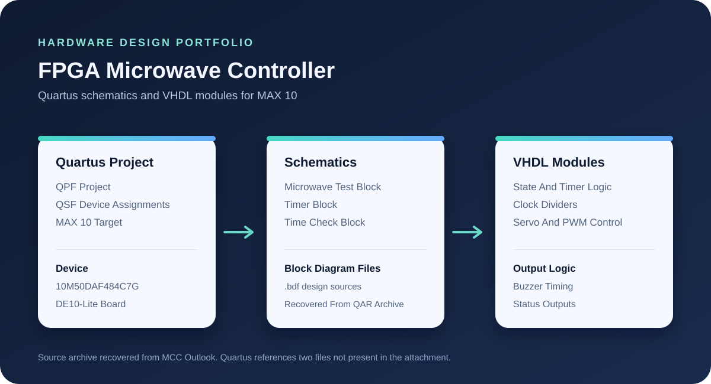

# FPGA Microwave Controller

Quartus schematics and VHDL support modules for a MAX 10 microwave controller project. The included design files cover timer and state logic, clock division, servo control, pulse-width modulation, and buzzer timing.

## Project Overview

The Quartus project targets an Intel MAX 10 device (`10M50DAF484C7G`) used on the DE10-Lite board. The project combines block-diagram schematics with VHDL modules for timing, control, and outputs.

## Source Map

| File Or Folder | Purpose |
| --- | --- |
| `MicrowaveCircuit.qpf`, `microwaveFinalProject.qsf` | Quartus project and device assignments |
| `microwaveFinalProjectTESTINGFILE.bdf`, `timerBlock.bdf` | Top-level test schematic and timer block schematic |
| `output_files/timeCheckBlock.bdf` | Time-check block schematic included in the archive |
| `Servo_Control.vhd` | Servo PWM position control and status outputs |
| `pwmGenerator.vhd` | Switch-selected PWM generation |
| `motorclockdiv.vhd` | Clock divider used by motor timing |
| `output_files/currentState.vhd` | Microwave state and control outputs |
| `output_files/clockDivider.vhd`, `output_files/buzerClock.vhd` | Clock division modules |
| `output_files/buzzerTimer.vhd` | Buzzer timing logic |
| `MicrowaveFinalProject_assignment_defaults.qdf` | Quartus assignment defaults from the archive |

## Archive Completeness

The source was recovered from the `MicrowaveFinal.qar` attachment in the MCC Outlook mailbox. The included Quartus settings reference two files that were not present in that archive: `microwaveFinalProject.bdf` and `output_files/ClockwiseCounter.vhd`. The archive does include `microwaveFinalProjectTESTINGFILE.bdf`, but its equivalence to the missing top-level schematic cannot be confirmed. Add the missing files or update the Quartus assignments before expecting a complete build. This project was not compiled after extraction.

## Build Notes

Use Intel Quartus Prime with MAX 10 support. Open `MicrowaveCircuit.qpf`, then review `microwaveFinalProject.qsf` and restore the missing files noted above. The QPF and QSF files retain Intel copyright and licensing notices; use them under the applicable Intel Quartus license terms.
